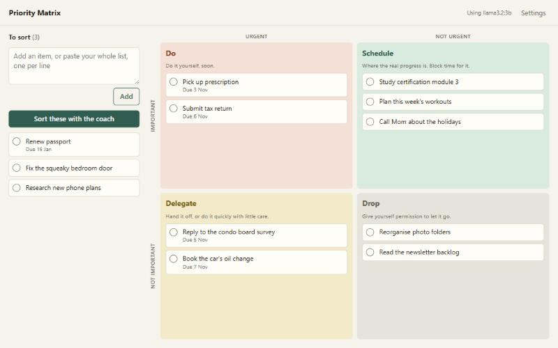
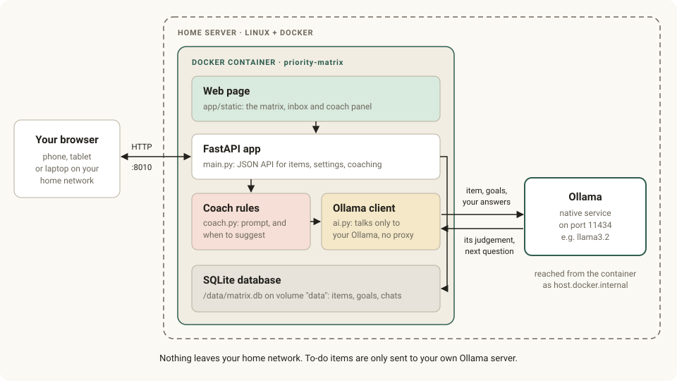

# Priority Matrix

Turns a to-do list into a decision about what matters. You paste your list, and a local AI coach walks you through it one item at a time with short questions, then suggests a square in the four-quadrant (Eisenhower) matrix:

|                   | Urgent     | Not urgent |
|-------------------|------------|------------|
| **Important**     | **Do**     | **Schedule** |
| **Not important** | **Delegate** | **Drop** |

- **You decide.** The coach asks and suggests; nothing moves until you place it. You can disagree in words or pick a square yourself at any time.
- **Importance is measured against your goals.** You write down what matters to you in Settings, and the coach uses that.
- **It doesn't guess.** Its first reply is always a question, and after three answers without a clear picture it hands the choice back to you.
- **It works without the AI.** If Ollama is down you can still add, drag and place items.
- **Private.** Items are only sent to your own Ollama server, and everything is stored in one SQLite file on the box.



## Documentation

- **[User guide](docs/user-guide.md):** the method, a walkthrough, tips for answering the coach, and a weekly routine.
- **[Architecture](docs/architecture.md):** how the parts fit together, how the coach decides, data, API, privacy and design choices.



## Start it

You need a Linux box with Docker, and Ollama running natively on it. Any small always-on PC or a Raspberry Pi 5 will do. If Ollama already serves another container on the box, skip step 2.

1. **Download the code** on the box:
   ```bash
   git clone https://github.com/mliebski/priority-matrix.git
   cd priority-matrix
   ```
2. **One-time Ollama setup.** Install Ollama and a model, then let containers reach it:
   ```bash
   curl -fsSL https://ollama.com/install.sh | sh
   ollama pull llama3.2
   sudo systemctl edit ollama
   ```
   Add these two lines in the editor, save, then run `sudo systemctl restart ollama`:
   ```
   [Service]
   Environment="OLLAMA_HOST=0.0.0.0:11434"
   ```
   Ollama has no password, so with ufw enabled allow only the Docker networks:
   ```bash
   sudo ufw allow from 172.16.0.0/12 to any port 11434 proto tcp
   ```
3. **Start the app** from this folder:
   ```bash
   docker compose up -d --build
   ```
4. Open `http://<box-ip>:8010` from any browser on your network.
5. Open **Settings**, describe what matters to you, pick a model and save.

The app has no login, so anyone on your home network can open it. Don't forward its port from your router.

## Configuration

To change a setting, copy `.env.example` to `.env`, edit it and run `docker compose up -d` again.

| Setting | Default | Purpose |
|---------|---------|---------|
| `APP_PORT` | `8010` | Port the app uses on the box |
| `TZ` | `America/Toronto` | Time zone for "today" and "overdue" |
| `OLLAMA_URL` | `http://host.docker.internal:11434` | Ollama address. Change it only if Ollama runs on another computer |
| `OLLAMA_MODEL` | none | Model to use if none is picked in Settings |

If no model is picked or set and only one is installed, the app uses that one. The model picked in Settings always wins.

## Using it

1. Type an item or paste your whole list, one per line. Bullets and checkboxes such as `- [ ]` are removed.
2. Press **Sort these with the coach**. Answer its questions, then accept the suggestion or pick another square. The next item opens by itself.
3. Set a due date on an item if it has one. The coach takes it into account.
4. Work from the matrix: **Do** first, and protect time for **Schedule**. Click a card to change or rethink it, drag it to move it, or tick the circle when it's finished.

On a CPU-only box the first answer can take a minute while the model loads. Later ones are quicker, because the model stays in memory for 15 minutes.

The [user guide](docs/user-guide.md) covers the method and daily use in more detail. The [architecture](docs/architecture.md) document explains how the coach decides.

## Troubleshooting

| What you see | Cause | Fix |
|--------------|-------|-----|
| **Failed to fetch** when adding an item | The page can't reach the app: the server stopped, or `index.html` was opened as a file | Check `docker compose ps`, and use the `http://` address rather than a `file://` one |
| **AI off: Ollama is not reachable** | The container can't reach Ollama | Check that Ollama is running and listening on `0.0.0.0`, and check the ufw rule from step 2 |
| **AI off: Pick a model in Settings** | Several models are installed and none is chosen | Choose one in Settings |
| **Model is not installed** | The chosen model was removed | Pick another in Settings, or pull it again with `ollama pull` |
| **Thinking…** runs for a long time | The model is loading, or is too large for the box | Wait up to 5 minutes, or use a smaller model |

The app keeps working when the AI is off, so you can still sort items yourself. To see the app's log, run `docker compose logs -f app`.

## Updating and backups

```bash
git pull
docker compose up -d --build
```

Your data lives in the Docker volume `data`, which rebuilding doesn't touch. `docker compose down -v` deletes it. To copy the database off the container:

```bash
docker compose cp app:/data/matrix.db ./matrix-backup.db
```

## Development

On Windows, in PowerShell:

```powershell
python -m venv .venv
.venv\Scripts\pip install -r requirements.txt pytest httpx
.venv\Scripts\python -m pytest tests
```

To try the app without Docker or a model, start a stand-in for Ollama in one window:

```powershell
.venv\Scripts\python tests\fake_ollama.py 8798
```

Then start the app in a second window and open `http://localhost:8000`. `DB_PATH` is needed because the default is the container's `/data` folder.

```powershell
$env:DB_PATH = "matrix.db"
$env:OLLAMA_URL = "http://127.0.0.1:8798"
.venv\Scripts\python -m uvicorn app.main:app
```

The stand-in plays a short scripted conversation, so it shows the flow but says nothing about how good a real model's questions are.

```
app/
  main.py     web API
  coach.py    the conversation: prompt, and when a suggestion is justified
  ai.py       client for the local Ollama server
  db.py       SQLite storage
  static/     the page
docs/         user guide, architecture, diagrams and screenshots
tests/
```

## License

[MIT](LICENSE)
