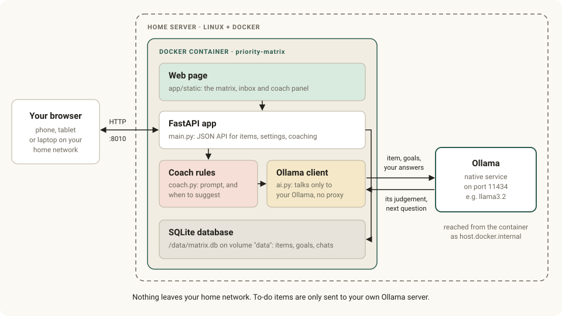
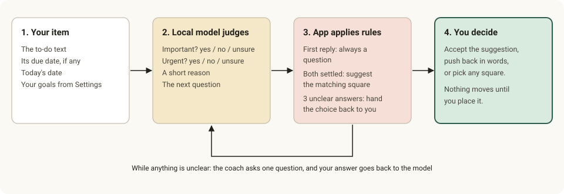

# Architecture

Priority Matrix is one small Docker container on a home server. It uses an Ollama AI that already runs natively on the same machine. There is no cloud service, no database server and no build step.

## Components

| Part | File | Role |
|------|------|------|
| Web page | `app/static/` | One HTML page with plain JavaScript and CSS, no framework or build. Shows the inbox, the matrix and the coach panel. |
| FastAPI app | `app/main.py` | Serves the page and a small JSON API, and validates all input. |
| Coach rules | `app/coach.py` | Builds the prompt and decides from the model's judgement whether to ask again, suggest a square or hand the choice back. |
| Ollama client | `app/ai.py` | Talks to Ollama over HTTP, and only to the address in `OLLAMA_URL`. Never uses a proxy. |
| Database | `app/db.py` | One SQLite file at `/data/matrix.db`, on the Docker volume `data`. |
| Ollama | on the host | Runs the language model. The container reaches it as `host.docker.internal:11434`. |

The container runs as an unprivileged user (uid 1000), and Docker restarts it if it stops. The only Python dependencies are FastAPI and uvicorn.

## How a coaching turn works

1. The page sends your answer to `POST /api/items/{id}/coach`, or an empty one to start the conversation.
2. The app checks that Ollama is reachable and a model is chosen. If not, it reports why, and the page falls back to manual sorting.
3. `coach.py` builds the messages:
   - a system prompt that defines *important* and *urgent*, and includes today's date, your goals, and the item with its due date and days left;
   - then the conversation so far.
4. `ai.py` calls Ollama's `/api/chat`. The JSON schema in `format` limits the answer to four fields: `important` and `urgent`, each `yes`, `no` or `unsure`, plus `reason` and `question`. Thinking is turned off, `temperature` is 0.2, and the model stays loaded for 15 minutes between items. An unreadable answer is retried once.
5. `coach.py` applies fixed rules to that answer:
   - The first reply is always a question, however sure the model is.
   - If both judgments are settled, the app maps them to a square itself. The model never names the square, so it can't contradict its own reasoning.
   - After three answers with something still unclear, the coach stops asking and leaves the choice to you.
   - If the model is unclear but asks no question, a built-in question is used.
6. The new message and any suggestion are saved only after the model has answered. A failed turn leaves nothing half-saved, and the same answer can simply be sent again.
7. A suggestion never moves the item. The item moves only when you place it. The reason stays on the card only if you put it where the coach suggested.

## Data

Two SQLite tables:

- **items**: `title`, `due`, `quadrant` (`do`, `schedule`, `delegate`, `drop`, or empty while in the inbox), `reason`, `chat` (the conversation as JSON), `suggestion`, `done_at` and `created_at`.
- **settings**: your goals and the chosen model.

## API

| Method and path | Purpose |
|-----------------|---------|
| `GET /health` | Health check used by Docker |
| `GET /api/state` | All items, goals and the chosen model |
| `GET /api/ai` | Whether Ollama is reachable, installed models, model in use |
| `PUT /api/settings` | Save goals and model |
| `POST /api/items` | Add one item, or many, one per line |
| `PATCH /api/items/{id}` | Change title, due date or square; mark done or not done |
| `DELETE /api/items/{id}` | Delete an item |
| `POST /api/items/{id}/coach` | Send an answer and get the coach's next reply |
| `DELETE /api/items/{id}/coach` | Forget the conversation for an item |

## Privacy and security

- **Data stays home.** Items, goals and conversations live in the SQLite file. They are only sent to the Ollama address you configure. The app makes no other outbound requests and loads no external fonts or scripts.
- **No login.** Anyone who can reach the port can read and change the list. Keep it on your home network, and never forward the port from your router.
- **Ollama has no authentication.** Let it listen on all interfaces so the container can reach it, then use a firewall rule to allow only the Docker networks. The README shows how.
- **Input is checked.** Titles are limited to 500 characters, answers to 2,000 and goals to 4,000. The page inserts all text as plain text, never as HTML.

## Design choices

- **The app decides the square, not the model.** Small local models are often confident and inconsistent. Asking them only two yes, no or unsure judgments, and enforcing the rules in code, keeps the coach predictable even on a 3B model.
- **Questions before answers.** The point is to help people think through their priorities, not to sort for them. So the first reply is always a question, and the person places every item.
- **SQLite in a volume.** One person's to-do list doesn't need a database server, and a single file is easy to back up.
- **No streaming.** Each reply is a short structured answer, so the page shows a *Thinking…* timer instead of streaming text.

## Limits

- One shared list with no user accounts.
- No reminders, calendar sync or recurring items.
- How good the questions are depends on the model. A 3–8B model such as `llama3.2` or `qwen3:8b` is a reasonable start on a mini PC.
- Dragging cards needs a mouse. On touch screens, tap a card and pick a square instead.

## Changing it

- **The coach's wording and definitions:** `SYSTEM` and `QUESTIONS` in `app/coach.py`.
- **How many answers before it hands the choice back:** `MAX_ANSWERS` in `app/coach.py`.
- **The squares' names and hints:** `QUADRANTS` in `app/static/app.js`.
- **Tests:** `tests/test_app.py` runs against `tests/fake_ollama.py`, a stand-in for Ollama, so no model is needed. The README's Development section shows how to run them.
