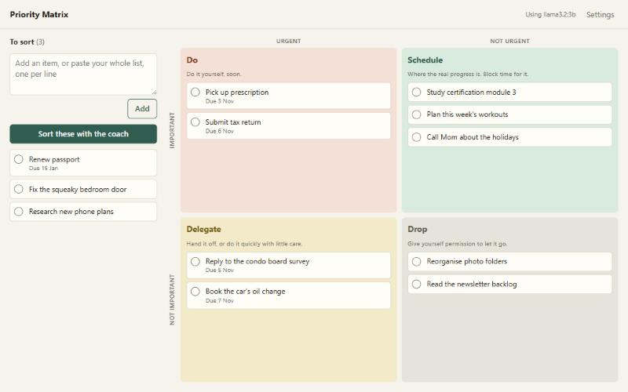
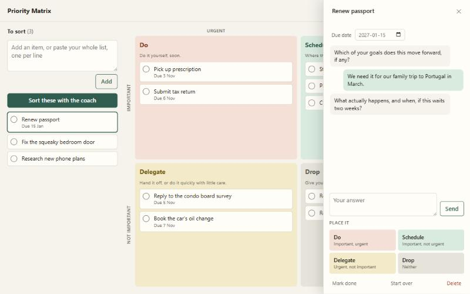
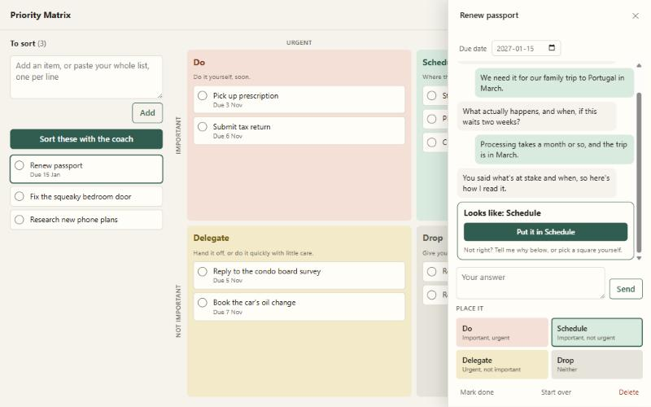

# User guide

Priority Matrix helps you decide what deserves your time, instead of working down a to-do list from the top. A coach that runs on your own server asks you a few short questions about each item, then suggests where it belongs. You always make the final call.

## Why a matrix instead of a list

A to-do list treats every item the same, so whatever feels most pressing tends to win. That is usually the urgent thing, not the important one. The four-quadrant matrix, often called the Eisenhower matrix, asks two separate questions about each item:

- **Is it important?** Does it move your goals, values or real responsibilities forward? Would never doing it have a lasting cost?
- **Is it urgent?** Does a real deadline or consequence hit in the next few days if you wait?

The two answers place each item in one of four squares:

| | Urgent | Not urgent |
|---|---|---|
| **Important** | **Do.** Handle it yourself, soon. *Filing a tax return due Friday.* | **Schedule.** Where real progress happens. Block time for it. *Studying for a certification. Exercise. Calling family.* |
| **Not important** | **Delegate.** Hand it off, or do it quickly without much care. *Answering a survey. Booking a routine appointment.* | **Drop.** Let it go. *Reorganising old photo folders. Clearing a newsletter backlog.* |

The **Schedule** square matters most. Its items never shout, so on a list they get pushed back forever. The matrix keeps them visible.

## Getting started

### 1. Tell it what matters to you

Open **Settings** and describe your current goals, roles and responsibilities in a few sentences. The coach judges importance against this text, so without it the coach can only guess what matters to you.

Good descriptions are concrete:

> Pass my project management certification by March. Stay healthy and active. Be present for my family, especially weekday dinners. Keep our finances in order.

Vague ones like "be productive" give the coach little to work with. Update this whenever your priorities change.

### 2. Add your to-do list

Type an item in the box under **To sort** and press Enter, or paste your whole list, one item per line. Bullets, numbers and checkboxes such as `- [ ]` are removed for you. Press Shift+Enter for a new line without adding.

### 3. Sort with the coach

Press **Sort these with the coach**. The coach panel opens for the first item and asks a question.

Answer in a sentence or two. The coach asks at most a few questions, then suggests a square and says why. Press the button to accept, and the next item opens by itself.

*These screenshots come from a scripted stand-in for the AI. A real model asks questions about your actual item.*

You don't have to agree. You can:

- **Push back in words:** "Actually the deadline moved to tomorrow." The coach takes that into account.
- **Pick a square yourself** under **Place it**. You can do this at any time, even before the coach has finished.
- **Start over** to have the coach forget the conversation for that item.

### 4. Work from the matrix

- Do the **Do** items first.
- Put time in your calendar for **Schedule** items.
- Hand off **Delegate** items, or batch them into one short session.
- Delete **Drop** items once you have truly let them go.

Tick the circle on a card when it's finished. Finished items are kept under **Finished** at the bottom of the inbox, where **Undo** brings one back.

## Answering the coach well

- **Be concrete about dates.** "The form is due on the 15th" helps more than "soon".
- **Name the consequence.** "If I miss it, I pay a late fee" or "nothing really happens" decides urgency and importance faster than how you feel about it.
- **Be honest about who wants it.** If something is urgent only because someone else is impatient, say so. That is a sign of **Delegate**, not **Do**.
- **Set a due date** in the coach panel when an item has one. The coach sees it, along with how many days are left.

## A simple routine

- **Daily, 5 minutes:** sort anything new in **To sort**, then pick today's work from **Do** and one item from **Schedule**.
- **Weekly, 15 minutes:** empty the inbox. Check that **Delegate** items were really handed off, and delete what you have let go in **Drop**. Book time for the most important **Schedule** items. Reread your goals in Settings.

## What your matrix is telling you

| You notice | It often means |
|---|---|
| **Do** is always overflowing | You are fire-fighting. Moving more time into **Schedule** prevents tomorrow's emergencies. |
| **Schedule** is empty | Your list is all reaction. Add the things that would really move your goals. |
| **Delegate** keeps growing | You are saying yes to other people's priorities. Hand more off, or decline. |
| Nothing ever lands in **Drop** | Most lists contain things that don't need doing. Letting them go is part of the method. |

## Changing an item later

Click any card to open it in the coach panel. There you can rename it, set or clear its due date, talk it through again, move it to another square, mark it done or delete it. On a computer you can also drag cards between squares, or back to **To sort**. On a phone, tap the card and pick a square.

## Questions

**Is my list private?**
Yes. Everything is stored on your own server, and items are only sent to your own Ollama AI, which also runs at home. Nothing goes to a cloud service.

**Does it need the internet?**
Only for installing and updating. Day-to-day use runs entirely on your home network.

**What if the AI is wrong?**
Ignore it. The coach suggests; you decide. It is built to ask rather than guess, and if three answers still don't make things clear it hands the choice back to you.

**What if the AI is off or slow?**
You can still add, sort and drag items yourself. The page shows *AI off* with the reason. On a server without a graphics card, the first answer can take a minute while the model loads; later ones are faster.

**Can I use it on my phone?**
Yes. Open the same address in your phone's browser. The layout adapts to small screens.

**Can several people use it?**
Everyone on your home network sees the same single list, and there are no accounts. It works best as one person's tool, or as a shared household list.
